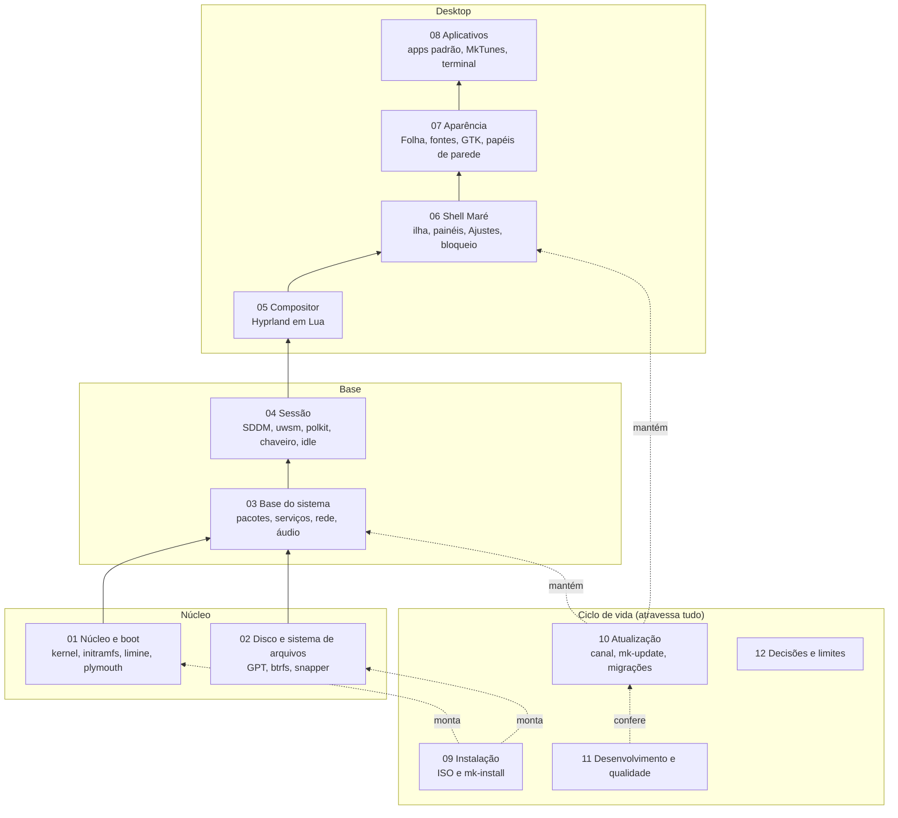

# Início

O Mk é um desktop Arch opinativo, voltado a desenvolvimento: Arch Linux com btrfs e snapshots do snapper, boot pelo limine, Hyprland 0.57 configurado em Lua e um shell próprio em Quickshell/QML chamado **Maré**. Tem instalador, ISO, canal de lançamentos e migrações próprios. Esta vault descreve o sistema por camadas, do núcleo à superfície, e em cada nota diz para que a peça serve e por que foi feita assim.

Esta é a nota de entrada (o mapa). Antes de seguir, leia [[Como ler esta vault]].

## As camadas

As camadas 01 a 08 são o sistema em execução, de baixo para cima. As camadas 09 a 12 não ficam "em cima" das outras: são o que monta, mantém, testa e explica todas elas.

## Mapa

### 01 Núcleo e boot
[[Fluxo de boot]] · [[Kernel e linha de comando]] · [[Initramfs]] · [[Limine]] · [[Entrada UEFI única]] · [[limine-default]] · [[Ganchos do limine]] · [[Plymouth]] · [[Microcódigo e perfis de hardware]] · [[LUKS]]

### 02 Disco e sistema de arquivos
[[Particionamento]] · [[Btrfs e subvolumes]] · [[Snapper e snap-pac]] · [[Voltar atrás pelo menu de boot]] · [[Swap e hibernação]]

### 03 Base do sistema
[[Listas de pacotes]] · [[Pacman e AUR]] · [[Serviços systemd]] · [[Rede]] · [[Firewall]] · [[Áudio]] · [[Impressão]] · [[Bluetooth]] · [[Usuários e sudo]] · [[Locale, fuso e teclado]] · [[Nome do sistema (os-release)]]

### 04 Sessão
[[SDDM]] · [[mk-session e uwsm]] · [[Variáveis de ambiente]] · [[Polkit]] · [[Chaveiro e agente SSH]] · [[Ociosidade e bloqueio]] · [[Energia e suspensão]] · [[Pasta do usuário]]

### 05 Compositor
[[Hyprland em Lua]] · [[Ordem de carga]] · [[Atalhos]] · [[Atalhos do usuário]] · [[Monitores]] · [[Recuperação de monitores]] · [[Regras de janela]] · [[Animações]] · [[Autostart]]

### 06 Shell Maré
[[Maré]] · [[Ilha]] · [[Painel líquido (Tide)]] · [[Monitor por tela]] · [[Clique fora e teclado exclusivo]] · [[Singletons]] · [[Painéis]] · [[Projetos e workspaces]] · [[Ajustes]] · [[Páginas dos Ajustes]] · [[Busca e calculadora]] · [[Emoji]] · [[Notificações e OSD]] · [[Boas-vindas]] · [[Tela de bloqueio]] · [[Descanso de tela]] · [[IPC do Maré]] · [[Scripts mare]] · [[Armadilhas do Maré]]

### 07 Aparência
[[Direção Folha]] · [[Fontes]] · [[Papéis de parede]] · [[Tema GTK, ícones e Qt]] · [[Ghostty]] · [[Fastfetch]] · [[Arte e geradores]]

### 08 Aplicativos
[[Apps padrão]] · [[Apps oferecidos]] · [[Apps do Mk (motor em Go, janela em QML)]] · [[MkPulso]] · [[MkPacotes]] · [[MkInstalar e MkComprimir]] · [[MkTunes]] · [[Ferramentas de desenvolvimento]] · [[Terminal e bash do Mk]] · [[Comando mk]]

### 09 Instalação
[[ISO]] · [[Instalador passo a passo]] · [[AUR na instalação]] · [[Modo desassistido]] · [[O que foi testado]] · [[Experimentar sem instalar]]

### 10 Atualização e ciclo de vida
[[Canal de lançamentos]] · [[mk-update]] · [[Migrações]] · [[Catálogo de migrações]] · [[mk-release]] · [[Atualizações na ilha e nos Ajustes]] · [[Quando a atualização para]] · [[Marca instalado-pelo-mk]]

### 11 Desenvolvimento e qualidade
[[Trabalhar no repositório]] · [[dev-shot]] · [[VM de teste]] · [[Testes e TDD]] · [[Checagens]] · [[Convenções]]

### 12 Decisões e limites
[[Registro de decisões]] · [[Motivos não registrados]] · [[Limitações conhecidas]]

## Ligações

Referência rápida: [[Glossário]] e [[Mapa do repositório]].
