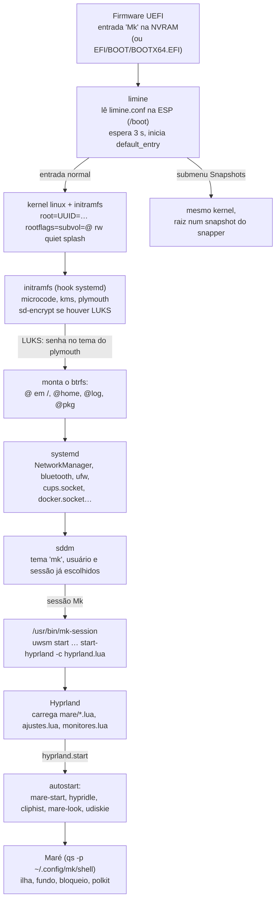

# Fluxo de boot

O caminho completo, do firmware até a ilha do Maré na tela. Cada caixa do diagrama tem a sua nota.

## Para quê

Para ver numa página só quem chama quem na subida do sistema, e onde cada peça do Mk entra.

## Como funciona

1. O firmware acha o limine pela [[Entrada UEFI única]] ou pelo caminho padrão da ESP.
2. O [[Limine]] mostra o menu por 3 segundos e inicia a entrada que o [[limine-default]] marcou.
3. O kernel sobe com a [[Kernel e linha de comando|linha de comando]] gravada em `/etc/default/limine`; o [[Initramfs]] mostra o [[Plymouth]], abre o [[LUKS]] se houver e monta a raiz ([[Btrfs e subvolumes]]).
4. O systemd liga os [[Serviços systemd]]; o [[SDDM]] apresenta a tela de login.
5. A sessão "Mk" roda o [[mk-session e uwsm|mk-session]], que inicia o Hyprland com a config de `<raiz>/hypr`.
6. O [[Autostart]] do Hyprland sobe o [[Maré]] e os processos de apoio.

## Por quê assim

O caminho de volta é parte do desenho: o menu do limine lista os snapshots, então uma atualização que quebra o sistema pode ser desfeita no boot (veja [[Voltar atrás pelo menu de boot]]). E há dois atalhos de emergência no Hyprland que funcionam mesmo se o último passo falhar (veja [[Atalhos]]).

## Onde está no código

- `installer/mk-install`: `configure_boot`, `finish_boot`, `configure_services`
- `system/mk/boot/limine-default`
- `bin/mk-session`
- `config/hypr/hyprland.lua`, `config/hypr/mare/autostart.lua`

## Ligações

Depende de: [[Particionamento]]. Continua em: [[SDDM]], [[Ordem de carga]], [[Maré]].
