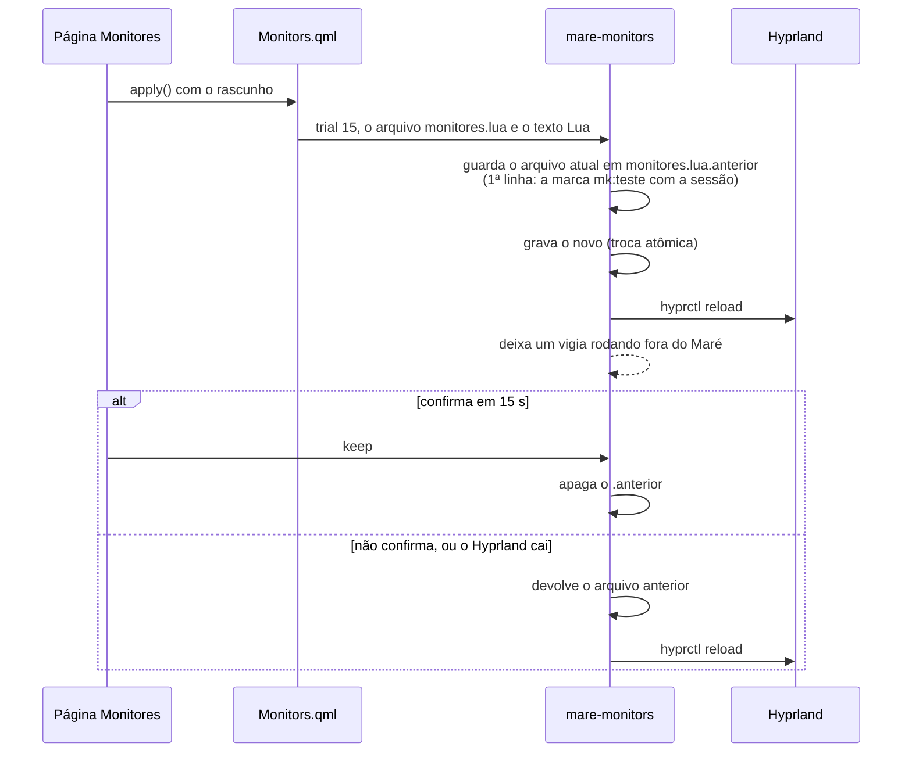

# Monitores

A configuração de telas tem uma regra de fábrica (escala 1 para tudo) e um arquivo gerado, `<raiz>/monitores.lua`, com uma regra por saída. Toda mudança feita pelos Ajustes é um **teste de 15 segundos** que volta sozinho se ninguém confirmar.

## Para quê

Resolução, taxa, escala, posição, rotação, espelhamento e ligar/desligar cada tela, sem o risco de ficar sem imagem.

## Como funciona

**Fábrica** (`display.lua`): `hl.monitor({ output = "", mode = "preferred", position = "auto", scale = 1 })`.

**O teste**, quando a pessoa clica em "aplicar":

- `Monitors.qml` guarda `live` (o que o Hyprland tem, de `mare-monitors list`) e `draft` (o rascunho do painel). Nada muda na tela até `apply()`.
- O texto Lua vem pronto do QML; o script não monta nada.
- O arquivo gerado guarda também a linha `-- mk:telas [...]`, com as telas da última vez, para não perder as desconectadas.
- Uma tela desligada só fica desligada enquanto houver outra: o próprio `monitores.lua` a religa quando ela fica sozinha.
- **O arranjador** (`arrange`, `islands`, `clash`, `enter`, `place` no `Monitors.qml`): a página arruma sozinha qualquer número de telas, sem sobreposição e sem tela solta. Pôr uma tela num lado já ocupado (`place`) empurra a que estava para além da que chegou, no mesmo eixo, em cadeia; um grupo que ficaria solto anda inteiro até encostar no desenho por um lado (só pelo canto não é encostar: o mouse não passa); uma tela religada, ou que deixou de espelhar, entra à direita do desenho (`enter`). Arrumar de novo o que já está arrumado não muda nada.

**Taxas acima da lista do monitor.** O script lê os limites que o monitor declara no EDID (bloco "Display Range Limits": `vmin`/`vmax` em Hz, `hmin`/`hmax` em kHz, o teto do pixel clock) direto de `/sys/class/drm/*/edid`. O `Monitors.qml` oferece as taxas inteiras acima da maior da lista, até o teto vertical, e para cada uma calcula um **modeline** com *blanking* reduzido (horizontal como no CVT-RBv2; vertical com o intervalo reduzido se couber, senão o maior que os limites deixam). O modo vira `mode = "modeline …"` na regra, e passa pela mesma contagem de 15 s.

## Por quê assim

- **Escala 1 por padrão**: "sem regra, o Hyprland escolhe a escala sozinho e pode dobrar tudo (2x) numa tela 1366x768", deixando a ilha e os painéis enormes e cortados.
- **Arquivo + reload, não `hyprctl eval`**: por `eval` o Hyprland 0.57 só reaplica a regra em telas ligadas e sem espelho; uma tela desligada não religa e um espelho não se desfaz. Recarregando a config, tudo vale ([[D13 Monitores por arquivo com vigia]]).
- **O vigia roda fora do Maré**: "assim a tela volta mesmo que o Maré morra ou a imagem suma". Ele também devolve o arquivo se o Hyprland cair com a configuração nova, e ao receber o sinal de término (o reflexo de quem ficou sem imagem é desligar a máquina).
- **Troca atômica** (`mktemp` + `mv`): o Hyprland nunca lê um arquivo pela metade, nem o vigia uma resposta vazia.
- **Modeline próprio em vez de `WxH@taxa`**: o `WxH@taxa` do Hyprland usa o CVT de *blanking* normal, "que estoura esses limites". Há também um mínimo de 25 linhas de intervalo vertical: com 12 a imagem falhou num monitor real.
- **Lógica pura separada no QML**: o cálculo de modelines fica entre os comentários `// --- puro: início ---` e `puro: fim` do `Monitors.qml`, de onde `tests/js/qml-puro.mjs` o tira para testar no node ([[Testes e TDD]]).
- **Limites do arranjador**: é guloso, não ótimo (um grupo solto pode encostar num lado que a pessoa não escolheria), e o que o Hyprland já traz torto de fora (um `hypr/monitors.lua` pessoal com telas sobrepostas) não é arrumado ao ser lido: a página só avisa. A lógica é testada com sorteios; a página nunca foi vista com três monitores de verdade.
- **FALLBACK e HEADLESS-n não contam** como telas do computador.

> [!warning] Limites conhecidos
> As regras são pelo **nome da saída** (`DP-1`…); não há regra por descrição (`desc:`). Os modelines calculados diferem dos testados à mão num dos monitores reais, e dois monitores físicos de larguras diferentes nunca foram testados ([[Limitações conhecidas]]).

## Onde está no código

- `config/hypr/mare/display.lua`
- `shell/mare/Monitors.qml` (`timing`, `modeline`, `lua`, `apply`, `keep`)
- `shell/mare/scripts/mare-monitors` (`list`, `trial`, `watch`, `restore`, `limits`)
- `shell/mare/SettingsMonitorsPage.qml`

## Ligações

Depende de: [[Hyprland em Lua]], [[Ordem de carga]], [[Pasta do usuário]]. Complemento: [[Recuperação de monitores]]. Usado por: [[Páginas dos Ajustes]], [[Monitor por tela]].
