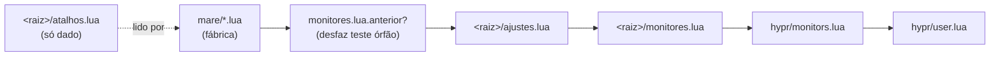

# Ordem de carga

O `hyprland.lua` carrega as coisas numa ordem deliberada: primeiro os módulos do Mk, depois o que os Ajustes geraram, por último os arquivos pessoais. Quem carrega depois prevalece.

## Para quê

Saber quem vence quando duas fontes dizem coisas diferentes sobre a mesma opção.

## Como funciona

1. **Módulos do Mk**, nesta ordem: `env`, `display`, `look`, `motion`, `input`, `binds`, `rules`, `autostart`.
   - O `binds` lê `<raiz>/atalhos.lua` por conta própria, como dado ([[Atalhos do usuário]]).
2. **Recuperação de monitores**: se existe `<raiz>/monitores.lua.anterior` de outra sessão, o arquivo anterior volta ([[Recuperação de monitores]]).
3. **Arquivos gerados pelos Ajustes**, na raiz: `ajustes.lua` e depois `monitores.lua`, cada um com `pcall(dofile, …)`.
4. **Arquivos pessoais**, ao lado do `hyprland.lua`: `monitors.lua` e `user.lua`, com `pcall(require, …)`.

Um erro num arquivo dos passos 3 e 4 não derruba a sessão: vira uma linha `Mk: <nome>.lua falhou: …` e a carga segue.

## Por quê assim

- **Fábrica antes, escolha depois**: o `ajustes.lua` só contém as linhas que os Ajustes mudam; aplicado por cima da fábrica, vence sem precisar repetir o resto.
- **`pcall` em tudo o que não é do Mk**: um arquivo gerado corrompido ou um `user.lua` com erro não podem deixar a pessoa sem sessão.
- **`atalhos.lua` não entra aqui**: "é só dado, e o `mare/binds.lua` já o leu, sem acesso a nada". Carregá-lo como código seria executar um arquivo que o shell escreve.
- **O pessoal por último**: o `monitors.lua` pessoal "carrega por último e prevalece" sobre o do painel. A página Monitores avisa quando uma saída tem regra ali (o campo `ruled`).
- **`package.path` começa pela pasta do próprio arquivo**: os módulos são achados "onde quer que ele esteja".

> [!warning] Os arquivos pessoais ficam numa pasta que a atualização troca
> Veja o aviso em [[Pasta do usuário]].

## Onde está no código

`config/hypr/hyprland.lua` (o arquivo inteiro tem 66 linhas).

## Ligações

Depende de: [[Hyprland em Lua]], [[Pasta do usuário]]. Detalhes: [[Atalhos do usuário]], [[Monitores]], [[Recuperação de monitores]], [[Ajustes]].
