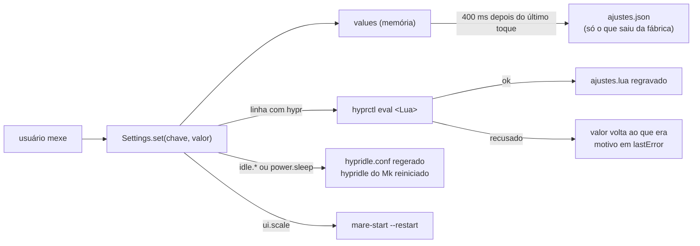

# Ajustes

Os Ajustes (`Super + ,`) são a central de configurações do Mk: uma folha no meio da tela, com as páginas à esquerda e uma busca que acha qualquer opção. Por trás, as páginas são **dados**, e o que se muda vale na hora.

## Para quê

Configurar o Maré e o Hyprland sem editar arquivos, com a garantia de que o que foi escolhido sobrevive às atualizações.

## Como funciona

**O esquema** (`SettingsSchema.js`): `groups` lista as páginas, `blurbs` tem o texto de cada uma e `rows` tem as linhas. Uma linha:

```js
{ page: "janelas", group: "ESPAÇOS", key: "hypr.gapsIn", label: "Entre janelas",
  desc: "O espaço que separa uma janela da outra", ctl: "slider",
  min: 0, max: 24, step: 1, def: 6, unit: "px", hypr: "general.gaps_in", kw: "gaps espaçamento" }
```

| Campo | Para quê |
|---|---|
| `key` | onde o valor fica no `ajustes.json` |
| `ctl` | `switch`, `slider` ou `choice` |
| `def` | o valor de fábrica (tem de ser o que o Mk usa sem `ajustes.json`) |
| `hypr` | o campo do Hyprland que a linha muda; sem ele, a linha é só do Maré |
| `kw` | palavras para a busca que o texto não usa |
| `quando` | a linha só aparece com outra chave num certo valor |
| `precisa` | `touchpad`, `bateria` ou `brilho`: some se a máquina não tem (`mare-caps`) |

**O ciclo de um valor** (`Settings.qml`):



- `get(chave)` devolve o valor gravado ou o de fábrica; um valor igual ao de fábrica **some** do arquivo.
- Um `hypr` que começa com `@` (`@animations`, `@kb_options`, `@monitor.scale`) entra no Lua por código próprio.
- Chaves sem linha desenhada ficam em `hidden`, só com o valor de fábrica (`apps.terminal`, `emoji.recent`, `emoji.tone`).
- **Acrescentar uma linha** é pôr o objeto em `rows` e ler com `Settings.get`. Não há terceiro passo: ela aparece na página, entra na busca, ganha a marca de "mudado" e entra no "voltar à fábrica".

## Por quê assim

- **A página é dado, não layout** (a ideia vem do Hub do Ryoku): o painel desenha todas as linhas do mesmo jeito e a busca procura em todas, sem código por opção ([[D11 Ajustes como dados]]).
- **Só o que saiu da fábrica é gravado**: se um padrão mudar numa versão nova, quem nunca mexeu naquela opção recebe o padrão novo.
- **O `ajustes.lua` só é regravado se o Hyprland aceitar**: assim o arquivo carregado no login nunca contém algo que o compositor recusa. Se recusar, o valor volta e o motivo aparece.
- **400 ms de espera**: um slider arrastado não escreve o arquivo a cada pixel.
- **`ajustes.json` ilegível não é sobrescrito**: fica onde está, uma cópia vai para `ajustes.json.quebrado`, `Settings.broken` fica verdadeiro e nada é gravado até a pessoa escolher começar do zero.
- **O esquema é a autoridade sobre o que vale**: o `ajustes.json` é um arquivo da pessoa e pode ter sido mexido à mão. Um valor só segue adiante (para o Lua do Hyprland, para o `hypridle.conf`) se for o que a linha aceita (`valid`: slider é número finito entre `min` e `max`; switch é `true` ou `false`; choice é uma das opções, do mesmo tipo). Se não, vale o de fábrica: quem lê um ajuste dentro do esquema usa `valueOf` (ou `clean`, para todos de uma vez), nunca `values[key]`. O painel ainda mostra o valor cru ([[Limitações conhecidas]]).
- **Escolha órfã** (`orphan`): o valor salvo de uma linha de escolha não é nenhuma das opções dela, porque sobrou de uma opção que o Mk tirou ("hibernar") ou veio torto. O painel avisa, em vez de mostrar a linha sem nada marcado.
- **Linhas somem quando não fazem sentido** (`precisa`, `quando`): um desktop sem bateria não mostra o aviso de bateria fraca.
- **Folha, não painel da ilha**: os Ajustes são uma janela *Overlay* própria (`mare-settings`) com teclado exclusivo; para o `Tide`, o modo `settings` é `rest`. O porquê de não descerem da ilha **não está registrado**.

## Onde está no código

- `shell/mare/SettingsSchema.js` (`groups`, `rows`, `hidden`, `hyprTable`, `hyprCode`, `hypridleConf`, `search`)
- `shell/mare/Settings.qml` (`get`, `set`, `reset`, `answered`, `syncIdle`)
- `shell/mare/SettingsWindow.qml` (`pageFiles`, o `Loader` das páginas próprias)

## Ligações

Depende de: [[Singletons]], [[Hyprland em Lua]], [[Pasta do usuário]]. Detalhes: [[Páginas dos Ajustes]]. Gera: [[Ordem de carga|ajustes.lua]], [[Ociosidade e bloqueio|hypridle.conf]], [[Atalhos do usuário|atalhos.lua]], [[Monitores|monitores.lua]].
