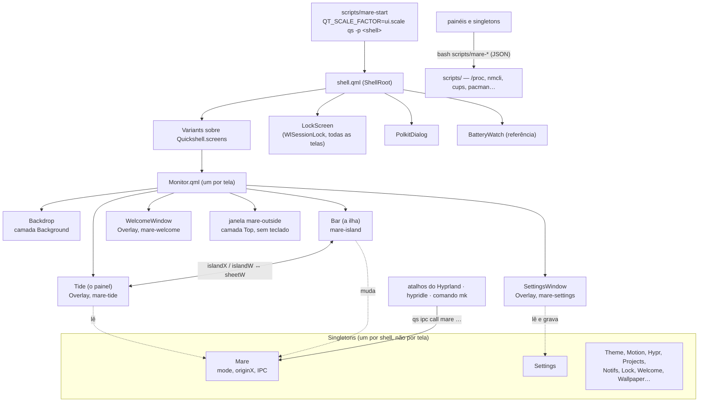

# Maré

O Maré é o shell do Mk: a ilha no alto da tela, os painéis que descem dela, o fundo, os Ajustes, as boas-vindas, a tela de bloqueio, o servidor de notificações e o agente de polkit. É Quickshell/QML numa pasta só, sem subpastas de código.

## Para quê

É tudo o que o usuário vê e toca fora das janelas dos apps. Substitui, num processo só, o que noutros desktops seriam barra, launcher, daemon de notificações, OSD, tela de bloqueio, seletor de papel de parede e central de configurações.

## Como funciona

**O estado central é uma string**, `Mare.mode`:

- `"rest"`: só a ilha;
- um nome da lista `Mare.panels`: aquele painel está aberto;
- `"toast"` ou `"osd"`: passageiros, voltam sozinhos para `"rest"` e não atropelam um painel aberto (`Mare.flash`).

`toggle`, `open`, `openAt` e `close` mudam o modo. Três nomes não seguem o caminho comum: `launcher` fica sempre carregado, `settings` é desenhado pela `SettingsWindow` (para o `Tide`, é `"rest"`), e `picker` não recebe teclado.

**Divisão de trabalho**: o QML desenha e guarda estado; o que é leitura do sistema ou ação nele fica em `scripts/` ([[Scripts mare]]).

## Por quê assim

- **Uma pasta só, sem subpastas**: cada arquivo `.qml` com letra maiúscula é um tipo que os outros usam pelo nome, sem `import` de módulos.
- **Um estado, uma string**: abrir um painel fecha o anterior por construção; não há combinações inválidas a tratar.
- **Em `<raiz>/shell`, não em `~/.config/quickshell`**: veja [[D01 Maré fora da pasta do Quickshell]].
- **`mare-start`**: o tamanho da interface é a escala do Qt (`QT_SCALE_FACTOR`), que só vale num processo novo. Padrão 85%.
- **O Maré também é launcher e servidor de notificações**, "então não há mako nem fuzzel" (comentário de `desktop.packages`).
- **Um singleton só existe se alguém o cita**: por isso a referência ao `BatteryWatch` no `shell.qml`.

## Onde está no código

`shell/mare/shell.qml`, `Monitor.qml`, `Mare.qml`, `shell/mare/README.md` (o guia de quem mexe no shell).

## Ligações

Depende de: [[Autostart]], [[Hyprland em Lua]], [[Pasta do usuário]]. Peças: [[Ilha]], [[Painel líquido (Tide)]], [[Monitor por tela]], [[Clique fora e teclado exclusivo]], [[Singletons]], [[Painéis]], [[Ajustes]], [[IPC do Maré]], [[Descanso de tela]], [[Scripts mare]], [[Armadilhas do Maré]].
