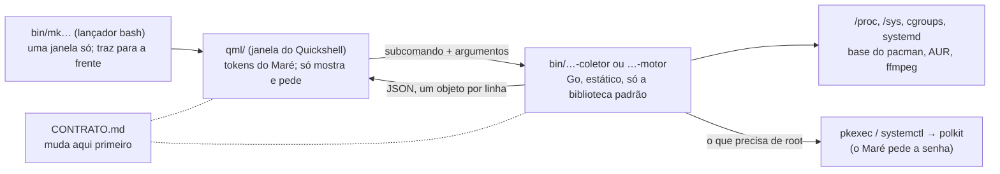

# Apps do Mk (motor em Go, janela em QML)

Os apps próprios do Mk (MkPulso, MkPacotes, MkInstalar, MkComprimir) seguem um molde só: um **motor em Go**, que lê o sistema e faz o trabalho, e uma **janela do Quickshell**, que só mostra o que o motor diz. Entre os dois há um contrato escrito.

## Para quê

Ter os utilitários do dia a dia (monitor de sistema, pacotes, instalar um arquivo baixado, comprimir um vídeo) com a cara do Maré, sem depender de um app de terceiros nem de uma ferramenta de terminal para cada um.

## Como funciona

Cada app é uma pasta em `apps/`:

| Peça | O que é |
|---|---|
| `src/` | o motor (ou "coletor"), em Go, só com a biblioteca padrão |
| `bin/<app>-coletor` ou `-motor` | o binário compilado, estático, **rastreado no git** |
| `bin/<app>-coletor.de` | de que código o binário saiu (a assinatura e a versão do Go) |
| `qml/` | a janela, com um `Theme.qml` próprio nos tokens do Maré |
| `bin/<app>` | o lançador |
| `CONTRATO.md` | o que o motor responde e a janela espera |
| `pack` | formata (`gofmt`), roda `go vet` e `go test`, compila e anota a assinatura |
| `assinatura` | o sha256 de todos os `.go` (menos os de teste) e do `go.mod` |
| `share/` | o `.desktop` e o ícone |

**As regras comuns dos contratos**:

- o motor escreve JSON em UTF-8 no stdout, um objeto por linha; um subcomando que falha escreve `{"erro": "frase em português"}` e sai com código diferente de 0;
- o que o motor não conseguiu saber é `null`, nunca 0 nem ausente;
- códigos de saída: `0` certo, `1` erro de uso ou de sistema, `2` **recusado por segurança**;
- o motor nunca pede senha, nunca roda como root e nunca chama o `sudo`; o que precisa de root passa pelo `pkexec` ou pelo `systemctl`, e quem mostra o pedido é o Maré ([[Polkit]]);
- raízes trocáveis por variável de ambiente (`MKPULSO_PROC`, `MKPACOTES_PACMAN_DB`, `MKUTIL_HOME`…) e comandos externos achados no `PATH`, para o teste pôr dublês na frente;
- o motor refaz as checagens que a janela já fez: "a janela não é de confiança".

**Como chegam à máquina**: a pasta `apps/` vai dentro de `/usr/share/mk` e o `mk-update` a troca junto com o resto. O comando, o atalho de menu e o ícone são **links** para lá (`system/mk/mkpulso-links`, `system/mk/apps-links`), postos pelo instalador e por migração. Uma máquina instalada não compila nada.

**Como abrem**: flutuando no centro, no tamanho deles (a regra `float-mkpulso` em [[Regras de janela]]).

## Por quê assim

- **Contrato escrito antes**: "muda aqui primeiro, depois nos dois lados". O motor e a janela podem ser testados separados, e a janela pode ser vista sem motor, com respostas gravadas (`MKPULSO_EXEMPLO=tests/apps/mkpulso-exemplo`).
- **Toda a lógica no motor**: é o lado que dá para testar sem tela. A conta que a janela faz sozinha (ordenar, estimar, os textos) mora num `.js` puro, testado no node.
- **Binário pronto no git, com assinatura**: o `tests/run` refaz a assinatura e reprova um binário que não é o do código que está no repositório. Sem isso, um lançamento poderia levar código novo com binário velho.
- **Estático, `-trimpath`, sem símbolos**: "para sair igual em qualquer lugar".
- **Só a biblioteca padrão do Go**: nenhuma dependência a baixar ou auditar. Onde ela não alcança (bases do pacman em zstd, squashfs em zstd/xz), o motor chama o comando do sistema.
- **Por que Go**, e não Python, Java ou Rust: segundo quem mantém, um binário único que vai pronto com o Mk, pouca memória, build em segundos, e a decisão de evitar Python. Esse motivo **não está escrito no repositório**; o que o código mostra é a escolha e as consequências dela ([[D17 Apps próprios em Go e QML]]).
- **Recusas no motor, com código próprio**: o que derruba a sessão ou a máquina é recusado antes de qualquer comando, e a janela só mostra a frase.
- **Testes com sistema de mentira**: `/proc` e `/sys` falsos, bases de pacman falsas, um AUR de mentira, homes falsas, comandos dublês. Nenhum teste manda sinal, mexe em serviço ou instala pacote de verdade.

> [!warning] O que foi visto e o que não foi
> Segundo `docs/limites.md`: os motores foram exercitados de verdade na VM (encerrar um processo, instalar e remover um pacote com a senha pedida pelo Maré, comprimir um vídeo, e as recusas). As janelas foram vistas abrindo com dados reais, mas **os botões nunca foram clicados**: as ações só rodaram contra dublês ou pela linha de comando.

## Onde está no código

`apps/README.md`; `apps/*/CONTRATO.md`; `apps/*/pack` e `assinatura`; `system/mk/mkpulso-links`, `system/mk/apps-links`; `tests/apps/`.

## Ligações

Depende de: [[Maré]], [[Direção Folha]], [[Polkit]], [[mk-update]]. Apps: [[MkPulso]], [[MkPacotes]], [[MkInstalar e MkComprimir]], [[MkCalc, MkCorte e MkEscrita]]. O caso à parte: [[MkTunes]]. Decisão: [[D17 Apps próprios em Go e QML]]. Testes: [[Testes e TDD]].
