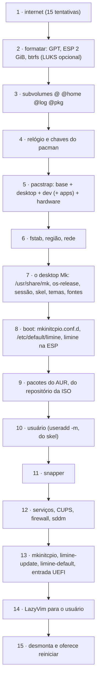

# Instalador passo a passo

`installer/mk-install` roda no live, como root, e instala o Mk num **disco inteiro**. Faz quatro perguntas, mostra uma revisão e, depois da palavra `formatar`, trabalha sozinho em etapas numeradas.

## Para quê

Transformar uma máquina vazia num Mk pronto em cerca de 15 minutos, quase tudo baixando pacotes.

## Como funciona

**Antes de tudo** (`preflight`): é root, o live está em UEFI, as ferramentas existem, `/mnt` não está montado.

**Validação** (`validate`, antes de tocar no disco, nos dois modos): disco inteiro que não é o do live, com 24 GiB ou mais; hostname, usuário e senha; `TIMEZONE` é um arquivo de `zoneinfo` (não uma pasta, não vazio); `LOCALE` casa ao pé da letra com uma linha de `SUPPORTED`; `KEYMAP` existe em `kbd/keymaps`; perfis de hardware conhecidos; `APPS`, `ENCRYPT` e `POWEROFF` são exatamente `sim` ou `nao`.

**As telas** (com `gum`; sem ele ou sem terminal, as mesmas perguntas em texto simples):

| Tela | O que pede |
|---|---|
| 00 Internet | só sem conexão: lista as redes Wi-Fi (`iwctl`) e pede a senha |
| 01 Disco | em qual disco; o pendrive do live não aparece |
| 02 Você | hostname (padrão `mk`), usuário, senha duas vezes |
| 03 Região | fuso, teclado e idioma, com padrões |
| 04 Drivers e apps | perfis de hardware (o detectado já marcado), apps gráficos (padrão sim), LUKS (padrão não) |
| 05 Revisão | o resumo e, em vermelho, o que há hoje no disco |

**As etapas** (15; 16 com LUKS):

Cada etapa tem a sua nota: [[Particionamento]], [[Btrfs e subvolumes]], [[LUKS]], [[Listas de pacotes]], [[Locale, fuso e teclado]], [[Usuários e sudo]], [[Initramfs]], [[Limine]], [[AUR na instalação]], [[Snapper e snap-pac]], [[Serviços systemd]], [[Firewall]], [[SDDM]], [[limine-default]], [[Entrada UEFI única]].

**Na etapa 7**, além de copiar, o instalador liga os apps (`mktunes-links`, `mkpulso-links`, `apps-links`), o instalador marca todas as [[Migrações]] como feitas (as de sistema em `/var/lib/mk/migrations`, as de usuário no skel) e grava `/var/lib/mk/apps-oferecidos`.

**Registro**: `/var/log/mk-install.log`, no live e (copiado antes de desmontar) no sistema instalado. Começa **depois** da revisão. A senha não é escrita nele.

## Por quê assim

- **A palavra `formatar`**, não um "sim/não": a primeira versão pedia o caminho do disco digitado, e a trava passou a ser a palavra (maiúsculas e espaços são ignorados; qualquer outra coisa cancela). Até a revisão nada foi alterado e `Ctrl+C` cancela.
- **O usuário é criado depois de encher o skel**: assim a home nasce pronta e "todo usuário criado depois nasce igual".
- **Instalação nova já tem o que as migrações fariam**: marcar todas como feitas evita que o primeiro `mk-update` repita tudo. O preço: se o instalador não fizer o que uma migração faz, a instalação nova fica sem a mudança ([[Convenções]]).
- **Falhas que não param** viram `AVISO:` em amarelo, cada um dizendo o que rodar depois: AUR, snapper, ufw, ícones, entrada na NVRAM, LazyVim. **Falhas que param**: sem internet, disco pequeno, partições que não aparecem, config que não chegou na home, `limine.conf` sem kernel.
- **`set -euo pipefail` e `trap cleanup EXIT`**: se parar depois do `formatar`, a última linha mostra o código de saída, o log e como tentar de novo (`umount -R /mnt`, `cryptsetup close mkroot`). Recomeçar formata de novo.
- **`sim` ou `nao`, e nada mais**: "um 'yes' aqui valeria 'nao' em silêncio: o disco ficaria sem LUKS".
- **`live_root`**: os caminhos do live que o instalador lê (`/proc/cpuinfo`, `zoneinfo`, `SUPPORTED`, `/sys/firmware/efi`, `pacman.conf`) passam por essa variável, vazia em uso normal; os testes a apontam para uma pasta falsa e carregam o instalador como biblioteca, sem chamar o `main` ([[Testes e TDD]]).
- **`fix_exec`**: depois de copiar o repositório para `/usr/share/mk`, o instalador devolve o bit de execução aos arquivos que começam com `#!` (scripts) ou com a marca ELF (binários compilados, como os motores dos [[Apps do Mk (motor em Go, janela em QML)|apps do Mk]]). O `mkarchiso` grava o `/usr/share/mk` do live inteiro como 644; copiado assim, o Mk instalado ficava sem nenhum script executável (o comando `mktunes`, que é um link para lá, não rodava).
- **`SNAP_PAC_SKIP=y` durante a instalação**: o pacman roda no disco novo sem configuração do snapper (ela só vem no fim), e o gancho do snap-pac escrevia "fatal library error, lookup self" no meio do log. A mensagem era inofensiva e assustadora.
- **O `pacman.conf` do live é copiado para um temporário** e ganha o repositório `mk-aur`; o do live não é alterado.
- **O live roda da memória**: o log do live some ao desligar.

## Onde está no código

`installer/mk-install` (a função `main` é o roteiro: `check_network`, `make_pacman_conf`, `partition`, `install_packages`, `configure_base`, `install_desktop`, `configure_boot`, `install_aur`, `create_user`, `configure_snapper`, `configure_services`, `finish_boot`, `user_extras`); `installer/README.md`.

## Ligações

Depende de: [[ISO]], [[Listas de pacotes]]. Monta as camadas 01 a 04. Relacionado: [[Modo desassistido]], [[O que foi testado]], [[Fluxo de boot]].
