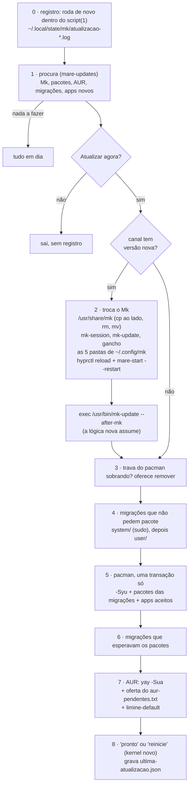

# mk-update

`mk-update` é o atualizador de um Mk instalado: num terminal, atualiza o próprio Mk pelo canal, roda as migrações, atualiza o Arch e o AUR, nessa ordem, e deixa um registro e um resumo.

## Para quê

Um comando só para manter tudo em dia. `mk atualizar` e o botão "atualizar tudo" dos Ajustes chamam o mesmo `/usr/bin/mk-update`.

## Como funciona

Detalhes de cada passo:

- **0. Registro.** Num terminal de verdade, o script se reexecuta dentro do `script(1)`. No fim o arquivo é limpo (cores, barras de progresso) e ficam os 5 últimos. Se nada foi aplicado, o registro da rodada é apagado.
- **2. A troca.** Clona o canal (raso), tira o `.git`, preserva o `aur-pendentes.txt`. Copia para `/usr/share/mk.novo`, apaga `/usr/share/mk`, renomeia. Para cada uma das cinco pastas de `<raiz>` que tem a marca (ou não existe): copia ao lado (`.novo`), move a antiga para `.velho`, move a nova para o lugar, apaga a velha. Grava `<raiz>/VERSION`.
- **5. Pacman.** Sem pacotes pedidos por migração: `pacman -Syu --needed <apps>`. Com eles: `pacman -Sy`, tira do pedido o nome que não existe mais, `pacman -Su --needed <pedidos> <apps>`.
- **Resumo.** Qualquer rodada que passou do "Atualizar agora?" grava `ultima-atualizacao.json` ao sair, com sucesso ou não: `when`, `started`, `ok`, `step` (`mk`, `ajustes`, `sistema`, `aur`), `reboot`, `applied`, `from`, `to`, `log`.

`mk-update --check` só mostra o que há, sem aplicar e sem registro.

## Por quê assim

- **O Mk primeiro, e depois `exec` para a versão nova**, "para que a lógica nova já valha nesta rodada": o resto (migrações, pacotes) roda com o atualizador que acabou de chegar. Consequência registrada na documentação: se o `mk-update` novo quebra num passo adiante, o conserto vem por outro lançamento, porque a procura e a troca rodam antes de todo o resto.
- **`script(1)` para o registro**: continua sendo um terminal de verdade (senha do sudo, perguntas e barras do pacman iguais), e a senha, que não aparece na tela, não vai para o registro.
- **Copiar ao lado e trocar com `mv`**: o Hyprland e o Maré vigiam os próprios arquivos. A versão que apagava a pasta e copiava a nova fazia o Hyprland recarregar no meio e mostrar "cannot open hyprland.lua".
- **Reiniciar o Maré inteiro** depois da troca: o recarregamento a quente não registra arquivos novos de singleton.
- **Migrações em dois tempos** (passos 4 e 6): veja [[D03 Migração não instala pacote]].
- **Uma transação só no pacman**: nunca se instala pacote novo sobre um sistema desatualizado.
- **Trava do pacman**: só oferece remover se não há `pacman`, `yay`, `makepkg` nem `pamac` rodando (`pgrep -x`).
- **Lê tudo de `/usr/share/mk`** (ou de `MK_SHARE`), não de um clone: no repositório ele é código-fonte, e o que roda é a cópia em `/usr/bin`.
- **`MK_ROOT`** troca a raiz de tudo o que é lido e escrito em `/usr`, `/var` e `/etc` (o mesmo `MK_ROOT` do `mare-updates`), e `MK_SHARE` troca só o `/usr/share/mk`; os comandos (`sudo`, `pacman`, `yay`, `git`…) vêm do `PATH`. Em uso normal as duas ficam vazias; servem aos testes (`tests/bin/mk-update.test.sh`).
- **Fechar a janela no meio** também grava o resumo: o `HUP` é repassado à rodada e tratado.
- **A troca de `<raiz>` vale para quem rodou**: outro usuário da mesma máquina continua com a versão antiga na pasta dele até rodar o `mk-update` também.

> [!note] O que a documentação não lista
> Além de `mk-session`, `mk-update` e do gancho, o código instala `/usr/bin/mk-hibernate` quando o arquivo existe no lançamento ([[Swap e hibernação]]).

## Onde está no código

`bin/mk-update` (391 linhas; o cabeçalho resume a ordem e o porquê); `docs/atualizacoes.md`.

## Ligações

Depende de: [[Canal de lançamentos]], [[Pacman e AUR]], [[Migrações]], [[Marca instalado-pelo-mk]], [[Scripts mare]]. Usado por: [[Comando mk]], [[Atualizações na ilha e nos Ajustes]]. Quando falha: [[Quando a atualização para]].
