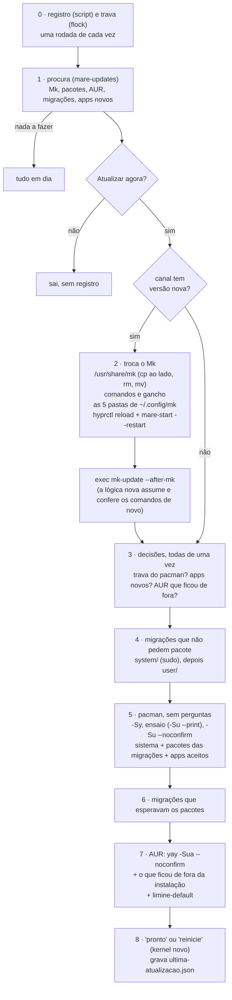

# mk-update

`mk-update` é o atualizador de um Mk instalado: num terminal, atualiza o próprio Mk pelo canal, roda as migrações, atualiza o Arch e o AUR, nessa ordem, com **uma confirmação só**, e deixa um registro e um resumo.

## Para quê

Um comando só para manter tudo em dia. `mk atualizar` e o botão "atualizar tudo" dos Ajustes chamam o mesmo `/usr/bin/mk-update`.

## Como funciona

Detalhes de cada passo:

- **0. Registro e trava.** Num terminal de verdade, o script se reexecuta dentro do `script(1)` (registro em `~/.local/state/mk/atualizacao-*.log`, os 5 últimos; apagado se nada foi aplicado) e dentro do `flock(1)`, com a trava em `$XDG_RUNTIME_DIR/mk-update.trava`. Uma segunda rodada diz "já há uma atualização rodando" e sai. O `--check` não trava nem é travado.
- **2. A troca.** Clona o canal (raso) numa pasta temporária, tira o `.git`, preserva o `aur-pendentes.txt`. Copia para `/usr/share/mk.novo`, apaga `/usr/share/mk`, renomeia. Para cada uma das cinco pastas de `<raiz>` que tem a marca (ou não existe): copia ao lado, troca com `mv`. Grava `<raiz>/VERSION`. `install_bins` copia, **só se mudou**, `mk-session`, `mk-update`, `mk-hibernate`, o gancho do os-release e o ajudante do DNS (`/usr/lib/mk/mk-dns`, [[Rede]]); roda na troca e de novo no `--after-mk`.
- **3. Decisões.** Depois do "Atualizar agora?", o que é decisão e não confirmação é perguntado em seguida, tudo antes da parte demorada: tirar a trava do pacman que sobrou, instalar os apps novos (e o LibreOffice, à parte), instalar no fim o AUR que ficou de fora.
- **5. Pacman.** `pacman -Sy`; sai do pedido o nome que não existe mais nos repositórios; um **ensaio** (`pacman -Su --print --noconfirm`, que não instala nada); e então `sudo pacman -Su --noconfirm`. O sudo é pedido uma vez (`sudo -v`) e renovado ao fundo enquanto a rodada durar.
- **Resumo.** Qualquer rodada que passou do "Atualizar agora?" grava `ultima-atualizacao.json` ao sair, com sucesso ou não: `when`, `started`, `ok`, `step` (`mk`, `ajustes`, `sistema`, `aur`), `reboot`, `applied`, `from`, `to`, `log`.

`mk-update --check` só mostra o que há, sem aplicar e sem registro.

## Por quê assim

- **Uma confirmação só**: com as decisões todas no começo, "dá para responder e sair de perto". Antes, o pacman e o yay paravam no meio esperando um "sim".
- **O ensaio antes da transação**: com `--noconfirm` o pacman responde o padrão a tudo, e o padrão de "qual destes provedores?" é o primeiro da lista: "seria escolher por você". Se o ensaio mostra essa pergunta, a rodada **para** e mostra o comando para rodar à mão. A troca de um pacote pelo sucessor que o Arch declarou ("Replace X with Y?") é aceita sozinha, como numa atualização feita à mão; conflito entre pacotes tem "não" como padrão, e o pacman para sem mexer em nada.
- **Sudo mantido**: o sudo esquece a senha em poucos minutos e a transação pode levar mais que isso; o passo seguinte pararia no meio pedindo a senha, "sem ninguém por perto".
- **Trava entre rodadas**: duas ao mesmo tempo "trocariam o `/usr/share/mk` uma por cima da outra e disputariam o pacman". A trava é do processo: some quando a rodada acaba ou morre, e não há o que destravar à mão. É por usuário; entre dois usuários da mesma máquina só a trava do pacman segura.
- **A pasta temporária some em qualquer saída** (no `finish`, que roda no `EXIT`).
- **O Mk primeiro, e depois `exec` para a versão nova**, "para que a lógica nova já valha nesta rodada". Os comandos são conferidos de novo no `--after-mk` porque quem fez a troca foi o `mk-update` de antes, "que só conhece a lista dele": um comando que a versão nova acrescentou chega na mesma rodada.
- **`script(1)` para o registro**: continua sendo um terminal de verdade, e a senha, que não aparece na tela, não vai para o registro.
- **Copiar ao lado e trocar com `mv`**: o Hyprland e o Maré vigiam os próprios arquivos. A versão que apagava a pasta e copiava a nova fazia o Hyprland recarregar no meio e mostrar "cannot open hyprland.lua".
- **Reiniciar o Maré inteiro** depois da troca: o recarregamento a quente não registra arquivos novos de singleton.
- **Migrações em dois tempos** (passos 4 e 6): veja [[D03 Migração não instala pacote]].
- **Uma transação só no pacman**: nunca se instala pacote novo sobre um sistema desatualizado.
- **Lê tudo de `/usr/share/mk`** (ou de `MK_SHARE`), não de um clone. `MK_ROOT` troca a raiz de tudo o que é lido e escrito em `/usr`, `/var` e `/etc`, e os comandos vêm do `PATH`: servem aos testes (`tests/bin/mk-update.test.sh`).
- **Sai da pasta que vai trocar** (`cd /` logo no começo): rodado de dentro de `/usr/share/mk`, depois da troca cada comando reclamava de `getcwd` dezenas de vezes (visto na VM).
- **Fechar a janela no meio** também grava o resumo: o `HUP` é repassado à rodada e tratado.
- **A troca de `<raiz>` vale para quem rodou**: outro usuário da mesma máquina continua com a versão antiga na pasta dele até rodar o `mk-update` também.

> [!warning] Lista nova, pacotes antigos
> Se a rodada parar entre o `pacman -Sy` e o `-Su`, o sistema fica com a lista de pacotes nova e os pacotes antigos: rode `mk atualizar` de novo antes de instalar qualquer pacote avulso. E a parada por escolha de provedor nunca foi vista numa atualização de verdade ([[Limitações conhecidas]]).

## Onde está no código

`bin/mk-update` (o cabeçalho resume a ordem e o porquê; `install_bins`, `segura_sudo`, o bloco do `flock`, o ensaio); `docs/atualizacoes.md`.

## Ligações

Depende de: [[Canal de lançamentos]], [[Pacman e AUR]], [[Migrações]], [[Marca instalado-pelo-mk]], [[Scripts mare]]. Usado por: [[Comando mk]], [[Atualizações na ilha e nos Ajustes]]. Quando falha: [[Quando a atualização para]].
